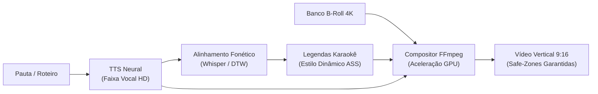

# ⚡ Nexus Content Engine — Plataforma de Mídia Programática & Vídeos 9:16

[](https://python.org)
[](https://ffmpeg.org)
[]()
[]()
[]()
[](LICENSE)
[]()

> **Transforme roteiros e pautas em vídeos verticais de alta retenção compilados em segundos.**  
> O `Nexus Content Engine` automatiza a geração de mídia programática (YouTube Shorts, TikTok, Reels), sincronizando vozes neurais, alinhamento fonético milimétrico para legendas estilo Karaokê e composição acelerada por GPU.

---

## ⚡ Quickstart

```bash
# 1. Clonar o repositório
git clone https://github.com/kazuhirokamim/nexus-content-engine.git
cd nexus-content-engine

# 2. Criar ambiente virtual e instalar dependências
python3 -m venv .venv
source .venv/bin/activate
pip install -r requirements.txt

# 3. Executar o operador de geração de vídeo
python run_operator.py --preset gta6 --topic "Novidades do Mapa de Vice City"
```

O vídeo final renderizado será exportado em `output/videos/`.

---

## 🏛️ Pipeline de Compilação Audiovisual



---

## 🚀 Diferenciais de Engenharia

- **Compilação Algorítmica de Vídeo:** Elimina o tempo manual em softwares de edição pesados. Um vídeo completo de 50 segundos é gerado em menos de 25 segundos.
- **Efeito Dopaminérgico Karaokê:** Alinhamento temporal com precisão menor que 60ms entre fala e transição cromática das palavras na tela.
- **Arquitetura Multi-Nicho com Presets Declarativos:** O motor principal é agnóstico. Troque de tema (Games, Curiosidades, Finanças) apenas apontando para um novo arquivo de configuração JSON.
- **Subprocess Security:** Execução do FFmpeg sem uso de interpretador shell (`shell=False`), prevenindo injeções de comando maliciosas.
- **Safe-Zones 9:16 Nativas:** Posicionamento de títulos e legendas imune à sobreposição dos botões de interface de TikTok, Shorts e Reels.

---

## 📁 Estrutura do Repositório

```
nexus-content-engine/
├── src/                            # Núcleo de TTS, composição e alinhamento fonético
├── presets/                        # Presets declarativos de nicho (GTA 6, etc.)
├── models/                         # Modelos e schemas de dados
├── documentation/                  # Acervo acadêmico, laudo pericial e vitrine
├── docs/                           # Guias operacionais e manuais
└── tests/                          # Suíte de testes unitários e de integração
```

---

## 📜 Licença

Distribuído sob a licença **MIT**.
