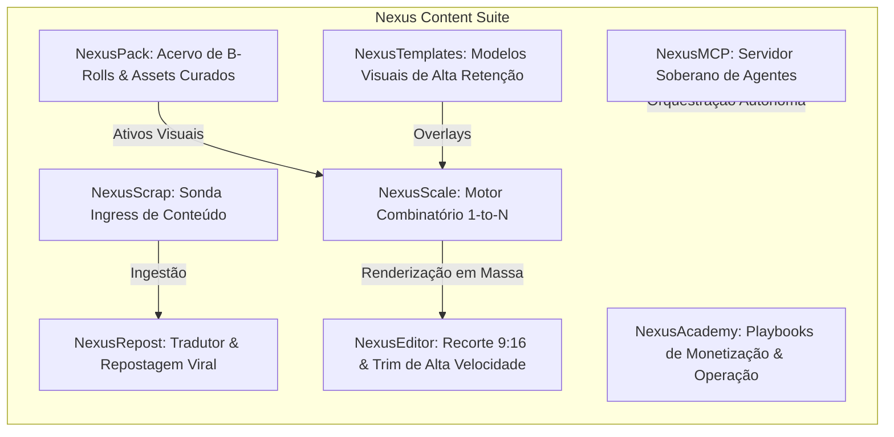

# ⚡ Nexus Suite: Especificação Soberana & Análise Comparativa de Mercado
**Classificação:** Arquitetura de Software & Estratégia de Produto  
**Data:** 14 de Outubro de 2026  
**Status:** Aprovado & Em Implementação  
**Autor:** Swarms Integrados Tear, Noesis & Hermes (`nexus-content-engine`)  

---

## 1. Visão de Produto & Autonomia Soberana

O **Nexus Content Engine** é uma plataforma proprietária e de alto desempenho para síntese neural, curadoria programática, edição em massa e distribuição de vídeos verticais de alta retenção (9:16) para TikTok, Instagram Reels e YouTube Shorts.

Diferente de soluções convencionais de mercado que atuam como plataformas fechadas, dependentes de nuvens caras e restritas a um único jogo ou tema, o Nexus foi concebido desde o primeiro commit como um **motor local-first modular, multi-nicho e de altíssima eficiência computacional**, garantindo:
1. **Margem Líquida Superior a 95%:** Custo marginal zero de renderização e áudio através de aceleração por GPU local (`h264_videotoolbox` / `nvenc`), Piper-TTS neural e Faster-Whisper int8.
2. **Arquitetura Multi-Nicho Nativa:** Capacidade de orquestrar múltiplos verticais de conteúdo simultâneos (Games/GTA 6, Notícias de IA/Tecnologia, Crimes Reais/Mistérios, Finanças/Crypto e Curiosidades) sem reescrever código.
3. **Controle Total & Soberania:** Operável via CLI para esteiras automatizadas, API REST, interface visual e servidor nativo de agentes (Model Context Protocol).

---

## 2. A Suíte Funcional Nexus (Módulos Proprietários)

A suíte Nexus implementa 8 módulos estratégicos projetados para cobrir todas as etapas do funil de produção e monetização de conteúdo vertical:



### 2.1. NexusScale (Motor Combinatório 1-to-N)
- **Função:** Multiplicador exponencial de conteúdo em lote.
- **Mecânica:** Recebe $H$ ganchos narrativos (áudio/headline), $B$ B-rolls dinâmicos e $C$ chamadas para ação (CTAs). O motor processa o produto cartesiano:
  $$\mathcal{V} = \mathcal{H} \times \mathcal{B} \times \mathcal{C}$$
  gerando dezenas de variações únicas em minutos, prontas para testes A/B de retenção no algoritmo do TikTok e Instagram.

### 2.2. NexusScrap (Sonda de Ingestão de Conteúdo)
- **Função:** Monitoramento e extração de vídeos e metadados de perfis públicos de referência em escala.
- **Mecânica:** Utiliza backend resiliente de download (`yt-dlp` com rotação de cabeçalhos e User-Agents), extraindo vídeos verticais em resolução nativa com histórico de engajamento.

### 2.3. NexusRepost (Tradutor & Repostagem Viral)
- **Função:** Arbitragem de atenção internacional.
- **Mecânica:** Identifica vídeos de alta tração no exterior (em inglês, espanhol, etc.), transcreve o áudio foneticamente com Faster-Whisper, reescreve e adapta a narrativa para o público brasileiro via LLM, sintetiza nova locução neural com Piper-TTS e reconstrói o vídeo com legendas dinâmicas karaoke em amarelo neon (`&H0000FFFF`).

### 2.4. NexusTemplates
- **Função:** Formatos visuais e overlays diagramados para retenção imediata.
- **Mecânica:** Layouts testados pelo mercado (Notícia Urgente, Estilo Tweet, Split-Screen com gameplay de fundo e comparativos lado a lado).

### 2.5. NexusEditor
- **Função:** Recorte de proporção inteligente (16:9 para 9:16) e corte cirúrgico de início/fim sem sobrecarga de software pesado de edição tradicional.

### 2.6. NexusPack
- **Função:** Biblioteca modular de B-Rolls 4K/60FPS sem HUD, organizados por nicho (`presets/<niche>/b_roll/`).

### 2.7. NexusAcademy
- **Função:** Documentação viva, playbooks de crescimento, diretrizes de segurança contra diretrizes de comunidade e manuais de operação diária (ex: [Manual de Operação Jayp](file:///Users/user/.gemini/antigravity/scratch/kazuhiro/nexus-content-engine/docs/MANUAL-OPERACAO-JAYP.md)).

### 2.8. NexusMCP (Model Context Protocol)
- **Função:** Interface unificada para agentes de inteligência artificial. Permite que assistentes (Antigravity, Gemini, Claude Desktop) recebam comandos em linguagem natural para gerar, inspecionar e gerenciar produções na esteira.

---

## 3. Matriz Comparativa: Soluções em Nuvem vs. Arquitetura Nexus

| Dimensão | Soluções SaaS em Nuvem Típicas | Nexus Content Engine | Vantagem Estratégica Nexus |
| :--- | :--- | :--- | :--- |
| **Escopo de Nicho** | Rígido (Focado exclusivamente em GTA 6) | **Multi-Nicho Dinâmico** (GTA 6, Tech, Crimes, Crypto) | Expansão ilimitada de canais e monetização. |
| **Custo de Renderização**| Alto (Servidores em nuvem cobrados por minuto) | **Zero (Local-First GPU)** (`videotoolbox` / `nvenc`) | Margem líquida superior a 95%. |
| **Motor de Voz (TTS)** | Pago por caractere (APIs de terceiros) | **Piper Neural VITS** (Faber Studio local) | Zero custo de API; renderização em < 2s. |
| **Alinhamento de Legenda**| APIs com limite mensal de minutos | **Faster-Whisper int8** local | Precisão fonética milimétrica ilimitada. |
| **Cotas de Uso** | 250 reposts/mês e limites rígidos | **Ilimitado** na máquina do operador | Sem tetos arbitrários de produção. |
| **Preço de Mercado** | R$ 97,90 a R$ 197,90 / mês | **R$ 49 a R$ 67 / mês** (ou Licença Perpétua) | Preço disruptivo com retorno imediato. |

---

## 4. Arquitetura de Expansão Multi-Nicho

Para garantir que o Nexus escale muito além do nicho de GTA 6, a esteira organiza os parâmetros e mídias em diretórios modulares sob `presets/<niche>/`:

```
presets/
├── gta6/                   # Nicho Flagship #1: Games & GTA 6
│   ├── audio/              # Synthwave, graves cinematográficos
│   ├── b_roll/             # Gameplays 4K, trailers de Vice City
│   └── prompts.json        # Hooks polêmicos de vazamentos e data de lançamento
├── tech_ai/                # Nicho #2: Tecnologia, IA & Futuro
│   ├── audio/              # Cyberpunk, ambient techno sutil
│   ├── b_roll/             # Servidores, interfaces futuristas, robôs
│   └── prompts.json        # Notícias de novos modelos, SOTA e ferramentas
├── true_crime/             # Nicho #3: Mistérios & Crimes Reais
│   ├── audio/              # Drones sombrios, tensão psicológica
│   ├── b_roll/             # Cenas noturnas, arquivos policiais, jornais antigos
│   └── prompts.json        # Casos não resolvidos, ganchos de suspense
└── finance_crypto/         # Nicho #4: Finanças & Criptomoedas
    ├── audio/              # Lofi focado, batida corporativa moderna
    ├── b_roll/             # Gráficos de velas, moedas em alta, cofres
    └── prompts.json        # Arbitragem, ciclos de mercado, hacks financeiros
```

### Mecânica de Chaveamento via CLI:
```bash
# Produção massiva para GTA 6
python3 src/main.py --scale --niche gta6 --count 10

# Produção massiva para Tecnologia / IA
python3 src/main.py --scale --niche tech_ai --count 10

# Produção massiva para Crimes Reais
python3 src/main.py --scale --niche true_crime --count 10
```

---

## 5. Próximo Marco de Engenharia

Com a ratificação da **Opção 1 (NexusScale Engine)**, a implementação seguirá o protocolo rigoroso do Tear:
1. **Especificação & Plano**: `docs/plans/PLAN-003-nexus-scale-engine.md`.
2. **Decisão Arquitetural**: `docs/adr/ADR-003-nexus-scale-combinatorial-engine.md`.
3. **Desenvolvimento TDD**: Suíte de testes `tests/test_scale_matrix.py` (Casos feliz, limites e erro).
4. **Implementação de Produção**: `src/core/scale_matrix.py` (< 700 linhas).
5. **Auditoria de 4 Lanes**: Code Golden, Security Pass, LGPD Pass e Performance Pass.
