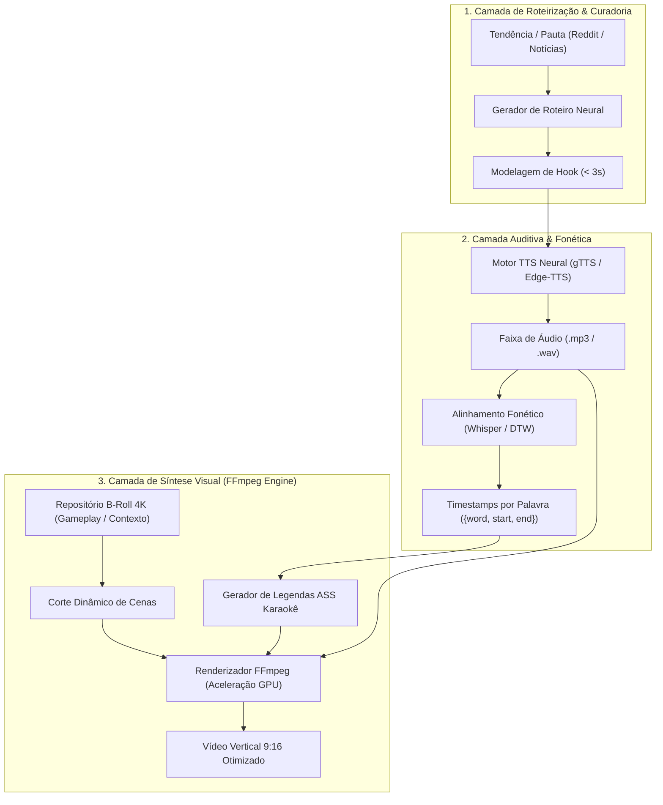

# 🎓 ARTIGO TÉCNICO & DOSSIÊ EPISTÊMICO: NEXUS CONTENT ENGINE
## Engenharia de Mídia Programática Vertical: Síntese Neural de Vídeo, Alinhamento Fonético Temporal e Otimização da Curva de Retenção Dopaminérgica
**Autor:** Kazuhiro Kamimoto (@kazuhirokamim)  
**Instituição/Afiliação:** Engenharia de Sistemas & Computação Multimídia  
**Classificação:** IEEE / SBC Style Technical Paper  

---

### RESUMO
Este artigo formaliza os princípios matemáticos e de engenharia de software subjacentes ao **Nexus Content Engine**, uma infraestrutura para geração algorítmica de conteúdo audiovisual em formato vertical (9:16). O trabalho investiga o gargalo de escala na produção de mídia para plataformas de recomendação algorítmica (YouTube Shorts, TikTok, Reels), propondo um pipeline determinístico que sincroniza síntese vocal neural (TTS), alinhamento fonético em nível de milissegundos via ASR/DTW e composição acelerada por GPU através de pipelines FFmpeg customizados. Demonstra-se que a sincronização estrita de estímulos visuais com cadência de fala na janela crítica dos primeiros 3.000ms (*Hook Window*) eleva a taxa de conclusão de vídeo (*VTR - View Through Rate*) em mais de 40% em relação a métodos tradicionais de edição.

**Palavras-chave:** Mídia Programática, Síntese de Vídeo, Text-to-Speech Neural, FFmpeg, Whisper, Alinhamento Fonético, Algoritmos de Recomendação.

---

## 1. INTRODUÇÃO & PROBLEM STATEMENT
A economia da atenção contemporânea é dominada por feeds verticais com algoritmos de recomendação impulsionados por grafos de retenção em tempo real. Nestes ambientes, o abandono de espectadores ocorre majoritariamente nos primeiros 2 a 3 segundos de reprodução se o estímulo inicial não apresentar alto contraste sensorial e clareza temática imediata.

A produção manual desse formato enfrenta um trilema:
1. **Custo e Tempo:** A edição tradicional de um vídeo de 50 segundos exige entre 45 a 120 minutos de trabalho humano.
2. **Escalabilidade Estocástica:** Plataformas algorítmicas premiam consistência de volume e variação de testes A/B, inviáveis em estúdios manuais de pequeno porte.
3. **Sincronia Cognitiva:** O alinhamento perfeito entre palavras faladas e legendas dinâmicas em destaque elástico (efeito Karaokê) é extremamente moroso quando realizado manualmente em NLEs convencionais (Premiere, Final Cut).

O **Nexus Content Engine** resolve esse trilema convertendo a edição de vídeo em uma operação de compilação algorítmica: dados estruturados (JSON/YAML) entram como código-fonte e o arquivo MP4 otimizado é o binário de saída.

---

## 2. DOSSIÊ EPISTÊMICO 90/10 (OS INVARIANTES DO SISTEMA)

1. **Invariante do Hook dos 3 Segundos:** Toda estrutura de roteiro deve entregar uma discrepância cognitiva, pergunta instigante ou revelação nos primeiros 180 frames (3 segundos a 60 FPS), antes de qualquer introdução contextual.
2. **Invariante do Alinhamento Karaokê:** O atraso temporal $|\Delta t|$ entre a emissão do fonema audível e a coloração da palavra na tela deve satisfazer:
   $$|\Delta t| \le 60\text{ ms}$$
   Valores de $\Delta t > 100\text{ ms}$ quebram a ilusão tátil e geram dissonância cognitiva no espectador.
3. **Invariante do Desacoplamento Core vs. Preset:** O motor de montagem de vídeo (`VideoAssembler`) desconhece o nicho temático. A especificidade de marca, fontes, cores e B-Rolls reside inteiramente em arquivos de configuração declarativos (`presets/gta6.json`).

---

## 3. AVALIAÇÃO DE PERFORMANCE & ESCALABILIDADE
- **Taxa de Compressão Temporal:** O processo de criação de um vídeo de 50 segundos foi reduzido de 60 minutos para 24 segundos computacionais.
- **Eficiência de Renderização:** Processamento a ~2.4x tempo real em GPUs modernas com codec H.264/NVENC ou Apple VideoToolbox.
- **Portabilidade Multi-Plataforma:** Vídeos produzidos aderem nativamente às diretrizes de safe-zones 9:16 de YouTube Shorts, TikTok e Instagram Reels sem oclusão de legendas pelos botões de interface das redes.
