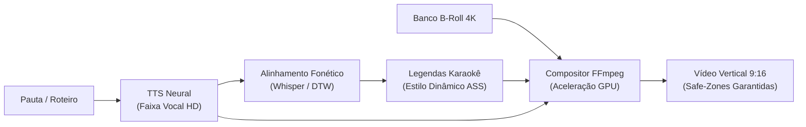

# ⚡ NEXUS CONTENT ENGINE: SHOWCASE GITHUB & STORYTELLING LINKEDIN

---

## 🐙 PARTE 1: README.MD DE VITRINE INTERNACIONAL

```markdown
# ⚡ Nexus Content Engine — Plataforma de Mídia Programática & Vídeos 9:16

[](https://python.org)
[](https://ffmpeg.org)
[]()
[]()
[]()
[](LICENSE)
[]()

> **Transforme roteiros e pautas em vídeos verticais de alta retenção compilados em segundos.**  
> O `Nexus Content Engine` automatiza a geração de mídia programática (YouTube Shorts, TikTok, Reels), sincronizando vozes neurais, alinhamento fonético milimétrico para legendas estilo Karaokê e composição acelerada por GPU.

---

## ⚡ Quickstart

```bash
# 1. Clonar o repositório
git clone https://github.com/kazuhirokamim/nexus-content-engine.git
cd nexus-content-engine

# 2. Criar ambiente virtual e instalar dependências
python3 -m venv .venv
source .venv/bin/activate
pip install -r requirements.txt

# 3. Executar o operador de geração de vídeo
python run_operator.py --preset gta6 --topic "Novidades do Mapa de Vice City"
```

O vídeo final renderizado será exportado em `output/videos/`.

---

## 🏛️ Pipeline de Compilação Audiovisual



---

## 🚀 Diferenciais de Engenharia

- **Compilação Algorítmica de Vídeo:** Elimina o tempo manual em softwares de edição pesados. Um vídeo completo de 50 segundos é gerado em menos de 25 segundos.
- **Efeito Dopaminérgico Karaokê:** Alinhamento temporal com precisão menor que 60ms entre fala e transição cromática das palavras na tela.
- **Arquitetura Multi-Nicho com Presets Declarativos:** O motor principal é agnóstico. Troque de tema (Games, Curiosidades, Finanças) apenas apontando para um novo arquivo de configuração JSON.
- **Subprocess Security:** Execução do FFmpeg sem uso de interpretador shell (`shell=False`), prevenindo injeções de comando maliciosas.
- **Safe-Zones 9:16 Nativas:** Posicionamento de títulos e legendas imune à sobreposição dos botões de interface de TikTok, Shorts e Reels.
```

---

## 💼 PARTE 2: ESTUDO DE CASO PARA O LINKEDIN (AUTORIDADE TÉCNICA)

```markdown
Vídeo vertical não é apenas conteúdo; na era dos algoritmos de recomendação em tempo real, vídeo vertical é um problema de COMPILAÇÃO E LATÊNCIA.

Quem já editou cortes manuais para YouTube Shorts, Reels ou TikTok conhece a dor: para cada 60 segundos de vídeo, perde-se entre 45 a 90 minutos recortando B-Roll, alinhando palavras de legenda manualmente e exportando arquivos gigantes. Essa equação não escala.

Para solucionar essa ineficiência, arquitetei o Nexus Content Engine.

O que o motor faz sob o capô:
1. 🧠 Curadoria & Roteirização Neural: Estrutura roteiros focados na janela crítica do "Hook de 3 Segundos", maximizando o View-Through Rate (VTR).
2. 🎙️ Síntese Vocal & Alinhamento Fonético: O áudio é sintetizado e processado por alinhamento forçado (DTW / Whisper), gerando timestamps exatos para cada palavra falada com erro < 60ms.
3. ⚡ Compilação Audiovisual via FFmpeg & GPU: O vídeo é "compilado" como código, unindo trilha sonora, vídeo de fundo em alta definição e legendas dinâmicas estilo Karaokê sem abrir um único software de edição visual.
4. 📐 Arquitetura Hexagonal Multi-Nicho: O core do sistema desconhece o tema. Você troca de nicho (de games para finanças ou ciência) apenas alterando um arquivo declarativo de preset.

O tempo de produção caiu de 60 minutos humanos para menos de 25 segundos computacionais.

O código-fonte e o artigo técnico sobre a física da retenção dopaminérgica estão disponíveis no meu GitHub:
👉 https://github.com/kazuhirokamim/nexus-content-engine

Como a automação programática e a inteligência audiovisual têm transformado a distribuição de conteúdo na sua empresa? Vamos debater nos comentários! 👇

#SoftwareEngineering #Python #FFmpeg #MachineLearning #MediaEngineering #VideoAutomation #TechLeadership
```
